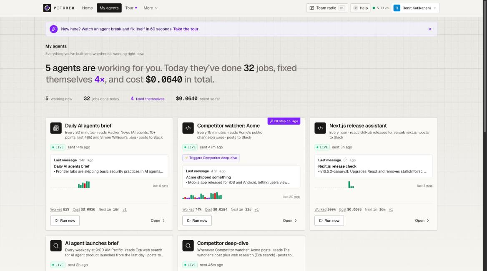
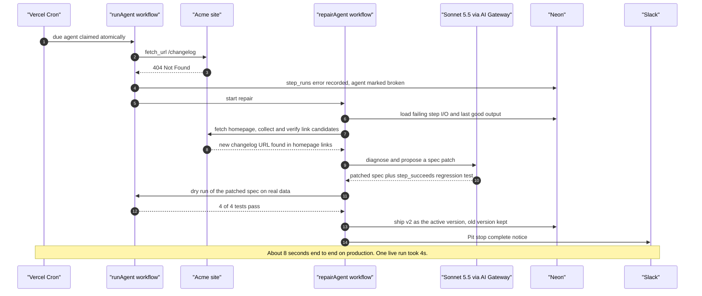
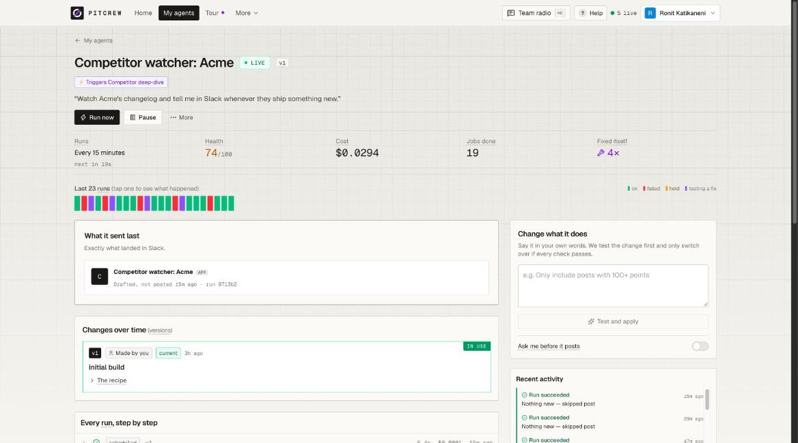
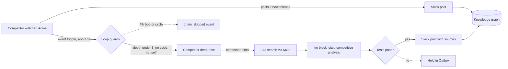
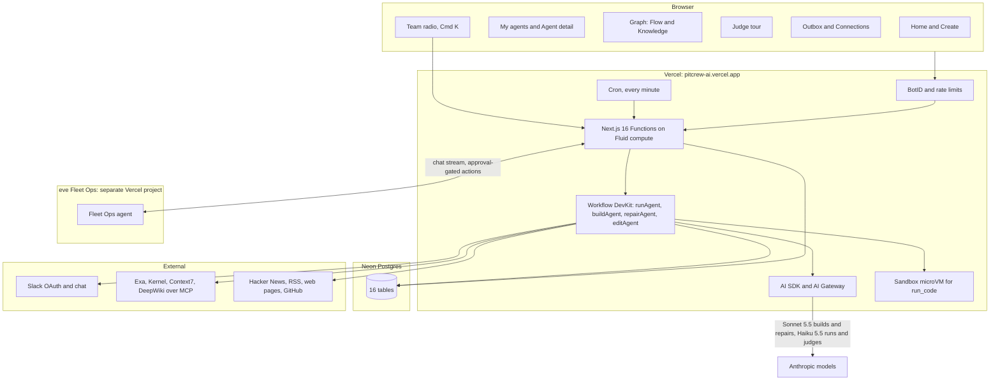
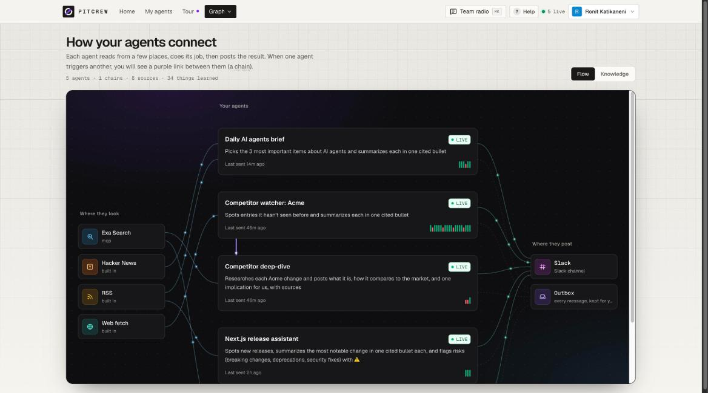
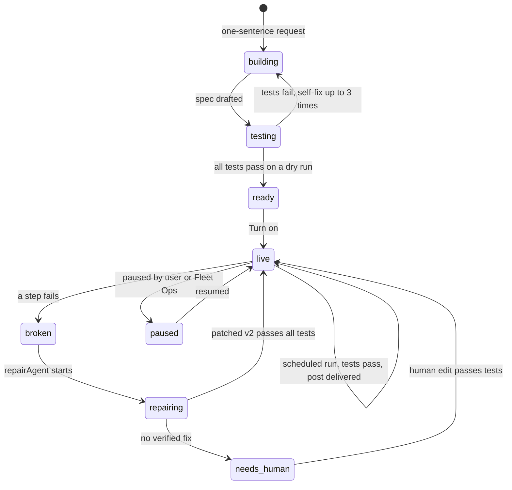
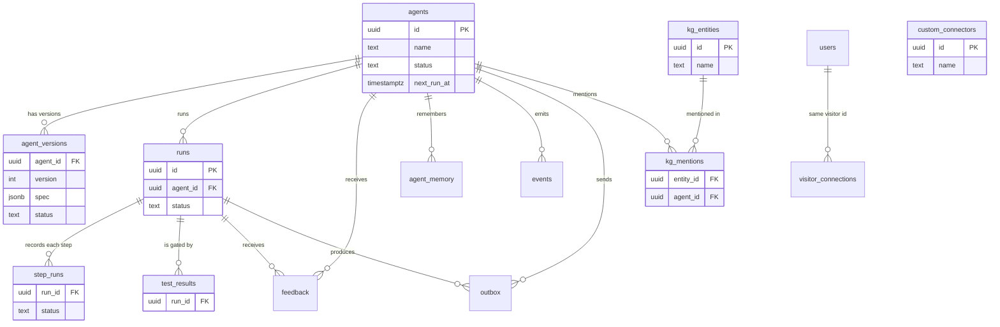
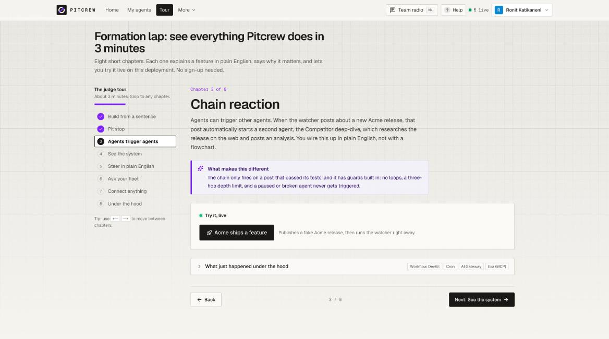

<div align="center">

# Pitcrew

### Your AI agents get a pit crew.

**Other tools help you build an agent. Pitcrew takes responsibility for keeping it running.**

[](https://pitcrew-ai.vercel.app)
[](https://vercel.com)
[](https://nextjs.org)
[](https://neon.tech)
[](https://agent-factory-ops.vercel.app)
[](#)

## [▶ Try the 3-minute judge tour](https://pitcrew-ai.vercel.app/tour)

<sub>No sign-in needed. Eight guided chapters, every feature live on production.</sub>

<br/>



</div>

<br/>

> **Why "Pitcrew"?** We built this at an event alongside an F1 team, so we leaned in. A race car doesn't finish without the crew that refuels it, swaps tires, and fixes damage in seconds. Every agent you build here gets one.

---

## What it does in 30 seconds

- **One sentence in, a tested agent out.** "Watch Acme's changelog and tell me in Slack when they ship." Pitcrew writes the spec, dry-runs it on real data, writes tests, fixes its own failures, and shows you a plain-English plan and a Slack preview before you turn it on.
- **Nothing ships unless the tests pass.** Every run is gated on the agent's tests. An LLM judge sees the source material and fails only verifiable violations.
- **It fixes itself.** When a source breaks, Pitcrew diagnoses it, finds the fix, proves it with a dry run, and ships v2 with a new regression test. On production this takes about 8 seconds.
- **Agents trigger agents.** A watcher's post kicks off a deep-dive agent that researches with Exa and posts a cited analysis about a second later.
- **You stay in control.** Plain-English edits, approval gates, 👎 feedback that becomes a proposed fix, and a ⌘K chat with an eve Fleet Ops agent that asks before it changes anything.

---

## The pit stop

The signature feature. The fake competitor site Acme "redesigns" and moves its changelog. The watcher's fetch returns 404. Pitcrew repairs it without a human:



The Slack notice reads **"🏁 Pit stop complete…"**. The agent page shows the version diff: the URL changed and one regression test was added. Failures become tests, so the same break can never ship silently again.

<div align="center">

</div>

---

## Chain reaction

Chains are data: an agent's spec can say "when agent A posts, run me with A's output". The Acme watcher feeds the Competitor deep-dive.



A real analysis from production: *"Acme launched iOS and Android apps… Power BI and Qlik lead on offline use… we should prioritize mobile alert workflows"*, with its source (basedash.com) cited.

**Loop guards:** an agent cannot trigger itself; a trigger that would form a cycle is rejected at build or edit time; chains stop at 3 hops (`MAX_CHAIN_DEPTH`) and the 4th hop is logged as a `chain_skipped` event.

---

## Architecture



<div align="center">

</div>

---

## How an agent is built

An agent is not generated code. It is a **JSON spec over a fixed block library** (`src/lib/spec.ts`, Zod-validated): a schedule, ordered steps, tests, and a plan card. Every build, edit and repair is a versioned diff that can be tested, shown, and rolled back.



The builder flow: **one sentence → spec → dry run on real data → tests → self-fix → plain-English plan → Slack preview → "Send me a test now" → Turn on.**

<details>
<summary><b>Example spec: the Acme competitor watcher</b> (from <code>src/lib/seed-specs.ts</code>)</summary>

```json
{
  "name": "Competitor watcher: Acme",
  "schedule": "*/15 * * * *",
  "requiresApproval": false,
  "steps": [
    { "id": "page", "block": "fetch_url", "params": { "url": "https://pitcrew-ai.vercel.app/demo/acme/changelog" } },
    { "id": "diff", "block": "diff_with_memory", "params": { "input": "{{steps.page.text}}", "memoryKey": "acme_changelog" } },
    {
      "id": "summary",
      "block": "llm",
      "params": {
        "instruction": "Summarize each new changelog entry in one bullet. Cite the page URL given as Source. If there are no changes return an empty list.",
        "input": "Source: {{steps.page.url}}\nNew entries:\n{{steps.diff.text}}",
        "format": "cited_bullets"
      }
    },
    { "id": "send", "block": "send_slack", "params": { "message": "*Acme shipped something*\n{{steps.summary.markdown}}", "skipIfEmpty": true } }
  ],
  "tests": [
    { "kind": "has_citations", "addedBy": "build" },
    { "kind": "no_post_if_unchanged", "addedBy": "build" },
    { "kind": "llm_judge", "config": { "rubric": "Only mentions changes present in the source; under 120 words." }, "addedBy": "build" }
  ],
  "plan": { "runs": "Every 15 minutes", "sendsTo": "Slack", "asksBefore": "Nothing" }
}
```

Steps reference earlier outputs with templates like `{{steps.page.text}}`. Blocks never throw; they return `{ ok, output | error }`, which gives repair precise evidence to work from.

</details>

---

## Feature tour

| Area | Feature |
|---|---|
| **Build** | One sentence becomes a Zod-validated spec, dry-run on real sources, revised up to 3 times from failed tests. |
| | Plain-English plan card, Slack preview, "Send me a test now", editable schedule, then Turn on. |
| | Export any proven agent as a standalone eve project. |
| **Run** | Vercel Cron ticks every minute and atomically claims due agents. |
| | Each run is a durable Workflow DevKit workflow, one step per block, every step's I/O recorded. |
| | Cost tracked per AI call: about $0.0003 to $0.001 per run. |
| **Test** | Test-gated delivery: nothing posts unless every test passes. Judge-only failures hold the post. |
| | LLM judge sees the source material and fails only verifiable violations. |
| **Repair** | Pit stop in about 8 seconds: diagnose, find a verified candidate, patch, re-test, ship v+1. |
| | Every repair adds a `step_succeeds` regression test for the exact break. |
| **Steer** | Plain-English edits ("only posts with 100+ points") produce a re-tested new version. |
| | `require_approval` pauses a run for a human; 👎 on a Slack post becomes a proposed fix. |
| | Team radio (⌘K): chat with the eve Fleet Ops agent; fleet-changing actions need approval. |
| **Connect** | Sign in with Slack: any visitor connects a workspace, and their agents post to their channel. |
| | Community connectors anyone can add (HTTP API or MCP). Exa, Kernel, Context7, DeepWiki connected; risky tools trimmed. |
| | Vercel Sandbox `run_code` block; GitHub for `github_issues`. |
| **Observe** | My agents: health, last output, run strip, sparklines, live activity feed. |
| | Graph page: Flow view (chains, connectors) and Knowledge view (34+ entities extracted across agents). |
| | Outbox for every message, delivered or held. Onboarding and Explain mode for first-time visitors. |

---

## Built with Vercel

| Product | What it does in Pitcrew |
|---|---|
| **Hosting + Fluid compute** | Serves the Next.js 16 app and APIs; runs long build, repair and Team radio streaming requests. |
| **Cron** | Ticks every minute and claims due agents with an atomic claim, so no agent runs twice. |
| **Workflow DevKit** | `runAgent`, `buildAgent`, `repairAgent` and `editAgent` are durable workflows, one retryable step per block. |
| **AI SDK + AI Gateway** | Structured generation and tool use. Sonnet 5.5 builds and repairs; Haiku 5.5 runs steps and judges. Cost per call recorded. |
| **Sandbox** | Firecracker microVM behind the `run_code` block. |
| **eve** | The Fleet Ops agent, deployed as its own project ([agent-factory-ops.vercel.app](https://agent-factory-ops.vercel.app)), plus Export as eve agent. |
| **BotID** | Blocks bots on public AI routes and Slack feedback links. |
| **Web Analytics** | Traffic on the app and tour. |
| **Speed Insights** | Core Web Vitals in production. |

**Neon.** All state lives in 16 Postgres tables, accessed through `@neondatabase/serverless` with parameterized SQL and no ORM. Rate limiting is Postgres-backed. Development runs on a Neon `dev` branch; production runs on an isolated `factory_prod` database. The project was provisioned through the Neon MCP.

---

## Data model



Also in `db/schema.sql`: `connections` (encrypted Slack, GitHub and connector credentials), `custom_connectors` (HTTP API and MCP definitions), and `demo_state` (Acme tour controls and the Postgres-backed rate-limit windows). `agents.owner_visitor_id` ties each agent to the visitor who built it.

---

## Block library

| Block | What it does |
|---|---|
| `fetch_url` | Fetch a page; return readable text and links. Fails on non-2xx. |
| `fetch_rss` | Read an RSS, Atom, or GitHub releases feed. |
| `hn_search` | Search Hacker News stories via Algolia. |
| `github_issues` | List open issues, or apply labels and comments. |
| `llm` | Summarize or classify; cited bullets may only use URLs present in the input. |
| `filter` | Keep items where a field passes `gt`, `gte`, `lt`, `lte`, `eq`, or `contains`. |
| `diff_with_memory` | Compare input with the last run and remember the new state. |
| `recall` | Read entities from the fleet knowledge graph. |
| `connector` | Call a custom connector (HTTP API or MCP tool). |
| `run_code` | Run code in a Vercel Sandbox microVM. |
| `send_slack` | Post to Slack with useful / not useful links; optional `skipIfEmpty`. |
| `require_approval` | Pause the run until a human approves or rejects. |

## Test kinds

| Test | Passes when |
|---|---|
| `nonempty` | The output has content. |
| `has_citations` | Every claim carries a source URL. |
| `max_items` | The output has at most `config.max` items. |
| `llm_judge` | A Haiku judge, given the source material, finds no verifiable violation of the rubric. |
| `no_post_if_unchanged` | Nothing is posted when the source did not change. |
| `step_succeeds` | A named step succeeds. Written by repair as the regression test. |

---

## Judge tour

<div align="center">

</div>

Open **[pitcrew-ai.vercel.app/tour](https://pitcrew-ai.vercel.app/tour)**. Public, no sign-in, every chapter runs against production:

1. **Build an agent from one sentence**
2. **Pit stop: it fixes itself** (Break, run, watch the repair, open the diff)
3. **Chain reaction** (Publish, the watcher posts, the deep-dive follows)
4. **See the whole system** (Flow and Knowledge graphs)
5. **Steer it in plain English**
6. **Ask your fleet** (⌘K Team radio with eve Fleet Ops)
7. **Connect anything** (Slack, MCP and HTTP connectors)
8. **Under the hood**

---

## Security & reliability

- **Test-gated delivery.** No version goes active and no message is posted unless its tests pass.
- **BotID** on public AI routes and feedback links, plus **rate limits** with per-key and global windows backed by Postgres.
- **SSRF guard.** Outbound fetches go through a guarded network helper.
- **Encrypted secrets.** Slack tokens, GitHub tokens and connector keys are encrypted at rest; none reach the client.
- **Approval gates.** `require_approval` steps and every fleet-changing Team radio action wait for a human.
- **Loop guards.** No self-triggers, no cycles, a 3-hop chain limit.
- **Abuse limits.** Minimum schedule interval and a live-agent cap per visitor; admin routes need `ADMIN_KEY`; the GitHub token is scoped to the connected repo.

---

## Run it locally

Prerequisites: Node 20+, a Vercel account, a Neon database.

```bash
git clone https://github.com/RonKat2008/agent-factory && cd agent-factory
npm i
vercel link && vercel env pull .env.local   # DATABASE_URL + VERCEL_OIDC_TOKEN for AI Gateway
npm run db:migrate                          # creates all 16 tables
npm run dev                                 # http://localhost:3000
npm run db:seed                             # second terminal: the 3 demo agents

# with the app running
curl -X POST "$APP_URL/api/demo/seed-chain?key=$ADMIN_KEY"     # add the chained deep-dive
curl -X POST "$APP_URL/api/knowledge/backfill?key=$ADMIN_KEY"  # fill the knowledge graph
```

<details>
<summary><b>Environment variables</b></summary>

| Variable | Purpose |
|---|---|
| `DATABASE_URL` | Neon Postgres connection string. |
| `AI_GATEWAY_API_KEY` | AI Gateway key; optional locally, where `vercel env pull` supplies an OIDC token. |
| `MODEL_SMART` / `MODEL_FAST` | Gateway models. Defaults `anthropic/claude-sonnet-5.5` and `anthropic/claude-haiku-5.5`. |
| `CRON_SECRET` | Bearer secret Vercel Cron sends to `/api/cron/tick`. |
| `ADMIN_KEY` | Guards admin and demo endpoints and the admin session. |
| `APP_URL` | Public base URL, used in Slack feedback links. |
| `SLACK_CLIENT_ID` / `SLACK_CLIENT_SECRET` | Slack app credentials for Sign in with Slack. |
| `SLACK_STATE_SECRET` | Signs the OAuth state. |
| `CONNECTIONS_KEY` | Encryption key for stored credentials. |
| `OPS_URL` / `OPS_API_KEY` | Where the app reaches the eve Fleet Ops agent, and its bearer key. |
| `GITHUB_TOKEN` | Optional fallback token for `github_issues`. |
| `DEMO_MODE` | `true` serves canned AI replies with no gateway access. |

</details>

The Fleet Ops agent lives in `ops-agent/` and deploys as its own Vercel project. `npm run verify` runs typecheck, lint and build.

---

## Project structure

```text
agent-factory/
├── src/
│   ├── app/(dashboard)/   # home, agents, new, graph, tour, outbox, connections
│   ├── app/api/           # agents, runs, cron, ops, slack, connectors, knowledge, demo
│   ├── workflows/         # run-agent, build-agent, repair-agent, edit-agent (Workflow DevKit)
│   ├── lib/blocks/        # the 12-block library
│   ├── lib/factory/       # generate, repair, link candidates, feedback edits
│   ├── lib/runtime/       # block runner, templating, tests, delivery
│   ├── lib/spec.ts        # the agent spec schema (Zod)
│   └── components/        # UI: fleet, agent, graph, tour, ops, onboarding
├── ops-agent/             # eve Fleet Ops agent (separate Vercel project)
├── db/schema.sql          # 16 tables
├── scripts/               # migrate, seed, smoke tests, preflight
└── docs/                  # DEMO, PITCH, SPEC, API, images
```

---

## What's next

- **A Neon branch per agent**, so every repair and edit dry-runs against its own copy of state before promotion.
- More community connectors and a shared connector gallery.
- Fleet-level repair insights: which sources break most, and which fixes held.

## Team

Ronit & Vidya 

---

<div align="center">
<sub>Built for Vercel Fast Forward · Agents & Factories track · <a href="https://pitcrew-ai.vercel.app">pitcrew-ai.vercel.app</a></sub>
</div>
